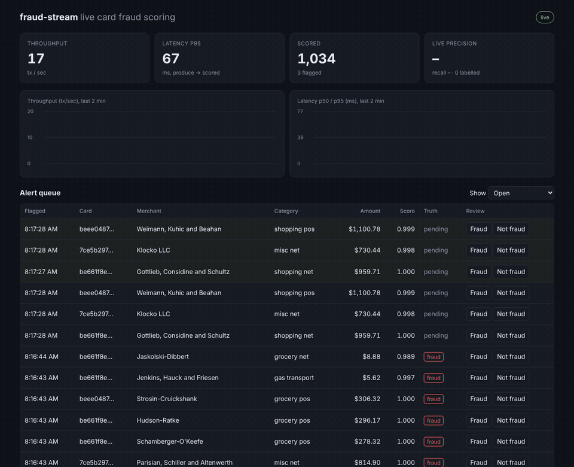
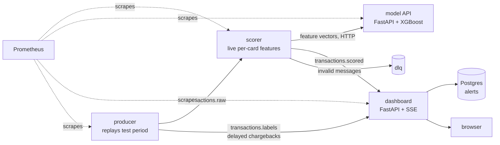

# fraud-stream

Real-time card fraud detection. Card transactions stream through Kafka, a scorer builds live
per-card features, an XGBoost model served by FastAPI scores each one, and flagged
transactions land in a review queue on a live dashboard. Everything runs locally with
Docker Compose.



## Results

| What | Result | How it was measured |
|---|---|---|
| Fraud precision (held-out test set, 555,719 transactions) | **0.940** (95% CI 0.929–0.950) | `make train`, Jun–Dec 2020 data the model never saw |
| Fraud recall (same test set) | **0.931** (95% CI 0.920–0.942) | 1,997 of 2,145 frauds caught, 128 false alarms |
| Live precision on the dashboard, first 60,000 test transactions | **0.924**: 232 caught, 19 false alarms, 19 missed | identical to the offline numbers for the same rows |
| End-to-end latency, 1,000 tx/s | **p50 8–9 ms, p95 14–17 ms** | `make bench`, Apple Silicon iMac, Docker Desktop, two runs |
| End-to-end latency, 2,500 tx/s | **p50 8–9 ms, p95 17–44 ms** | same; the p95 varies between runs |
| 5,000 tx/s target | **p50 11–15 ms, p95 83–394 ms; run 2 reached 4,872 tx/s** | same; target not met, see [Performance](#performance) for where the tail comes from |
| Outage drill | **0 lost, 0 double counted** | `make drill`: scorer killed, model API and Postgres stopped under load |

End-to-end latency is measured per transaction, from the moment the producer hands it to
Kafka until the scorer has its fraud score.

## Architecture



- **producer** replays the held-out test period at a fixed rate and sends each true label a
  few seconds later, the way chargebacks arrive in real life. A new run resumes right after
  the newest event already in Kafka, so back-to-back demos form one continuous stream.
- **scorer** loads every card's training-period history at startup (about 1.3M rows, ~20 s),
  so live features are exactly the ones the model was evaluated on. It builds 24 features per
  transaction and scores pipelined micro-batches through the model API: while one batch is
  being scored, the next is already read and prepared. Topics are keyed by card, so a card's
  events reach the scorer in order. Offsets are stored only after the results are safely in
  Kafka (at-least-once). Invalid messages go to the `dlq` topic.
- **model API** loads the model only if its SHA-256 and feature list match `metadata.json`,
  and requires an `X-API-Key`.
- **dashboard** shows live throughput, latency percentiles and live precision/recall (joined
  from the delayed labels), plus an alert queue where a reviewer marks alerts fraud or false
  positive.

Stack: Python 3.12, Apache Kafka 3.8 (KRaft), confluent-kafka, FastAPI, XGBoost, PostgreSQL 16,
Prometheus, Grafana, Docker Compose, uv, ruff, mypy (strict), pytest.

## Data

The model trains on the free Kaggle dataset
[Credit Card Transactions Fraud Detection](https://www.kaggle.com/datasets/kartik2112/fraud-detection)
(synthetic, generated with Sparkov; about 1.85M transactions from 1,000 cards, 2019–2020).
The data is not included in this repository. Download the zip, then:

```bash
make data SRC=~/Downloads/archive.zip   # clean it; personal fields are dropped here
make train                              # features, XGBoost, threshold, test metrics -> models/
make report                             # print the metrics again
```

Time-based split: train is the first 85% of `fraudTrain.csv`, validation the last 15%, and test
all of `fraudTest.csv`. Every modelling choice was made on validation; test was evaluated once
([experiment log](docs/model-experiments.md)). The threshold is the highest-recall point with
validation precision of at least 0.95.

## Requirements

- Docker with Compose v2.20 or newer (Docker Desktop is fine), about 6 GB RAM for the stack
- [uv](https://docs.astral.sh/uv/) 0.5 or newer (it installs Python 3.12 for you)
- GNU make and bash (macOS and Linux have them; on Windows use WSL2)
- macOS only: the OpenMP runtime XGBoost needs, via `brew install libomp`

## Quick start

```bash
cp .env.example .env            # then replace every CHANGE_ME value (services refuse to start otherwise)
make install                    # .venv with dev tools + pre-commit hook
make check                      # lint, strict type check, unit tests with coverage gate
make data SRC=~/Downloads/archive.zip
make train
make up                         # build and start the stack (waits until healthy)
make demo RATE=1000 MAX=60000   # stream 60k transactions; MAX=0 means no limit
make test-integration           # integration + end-to-end tests against the running stack
make bench RATES="1000 5000"    # throughput and end-to-end latency, read from Prometheus
make drill                      # outage drill under load (see Resilience)
make audit                      # dependency vulnerability scan (pip-audit)
make down                       # stop (keeps data); `make clean` also deletes the data volumes
```

| Service    | URL from your machine        | Notes                                    |
|------------|------------------------------|------------------------------------------|
| Dashboard  | http://localhost:8000        | live stats and alert review queue        |
| Model API  | http://localhost:8001/docs   | needs `X-API-Key` from `.env`            |
| Kafka      | `localhost:29092`            | topics are created by `kafka-init`       |
| PostgreSQL | `localhost:5432`             | `alerts` table from `infra/postgres/init.sql` |
| Prometheus | http://localhost:9090        | scrapes every service                    |
| Grafana    | http://localhost:3000        | user `admin`, password from `.env`       |

All ports are bound to `127.0.0.1` only.

## Accuracy: live equals offline

The model was evaluated on features computed over each card's full history. The first live
version gave each card only 7 days of history, and live precision fell from 0.94 to 0.86.
Replaying the test set offline with 7, 30 and 90 days of history gave 0.889, 0.894 and 0.907,
so the gap came from the history, not the model. The scorer now loads the full history at
startup, rebuilds recent history after a crash, and the producer resumes instead of repeating
dates. On the first 60,000 test transactions the live dashboard counts 232 caught, 19 false
alarms and 19 missed, the same as offline. That holds after the outage drill and across two
back-to-back demo runs. A unit test
(`test_scorer_with_history_matches_offline_test_features`) keeps it that way.

## Performance

`make bench` streams at each target rate, skips a 10 s warm-up, and reads achieved throughput
(from the scorer's own counter and the exact scrape times) and latency percentiles from
Prometheus histograms. It also reports how much of the latency is the Kafka leg (producer to
scorer) and how long the model API calls take.

Apple Silicon iMac, Docker Desktop, two separate runs (achieved throughput was only recorded for run 2):

| Target tx/s | Run | Achieved tx/s | p50 ms | p95 ms | p99 ms | Kafka leg p95 ms | Model call p95 ms |
|------------:|----:|--------------:|-------:|-------:|-------:|-----------------:|------------------:|
| 1,000       | 1   | n/a           | 8.8    | 16.8   | 41.0   | n/a              | 4.6               |
| 1,000       | 2   | 1,000         | 8.3    | 14.3   | 28.3   | 12.4             | 3.8               |
| 2,500       | 1   | n/a           | 8.5    | 17.4   | 37.2   | n/a              | 4.8               |
| 2,500       | 2   | 2,500         | 9.2    | 43.9   | 358.6  | 29.4             | 6.4               |
| 5,000       | 1   | n/a           | 11.4   | 82.7   | 239.6  | n/a              | 9.0               |
| 5,000       | 2   | 4,872         | 14.6   | 394.0  | 990.9  | 342.5            | 13.8              |

At 1,000 tx/s the p95 is at or under the 15 ms target. Above that the median stays low
(9 to 15 ms) but the tail is unstable between runs, and the 5,000 tx/s target is not met.
The wait is not in the model: model calls stay under 14 ms at p95. Most of it is the Kafka
leg (producer to scorer), where the single Python scorer process falls briefly behind and
messages queue. The next steps would be a second scorer process (which needs the shared state
store described under limitations) or moving feature computation out of Python.

How the tail was cut (5,000 tx/s target, 4-vCPU sandbox): p95 958 ms → 186 ms.

- Model API: request parsed straight from bytes by pydantic-core, response written once with
  orjson, XGBoost threads capped at the container's CPU limit (`MODEL_API_THREADS`).
- Scorer: up to `SCORER_MAX_INFLIGHT` batches at the model at once; Kafka delivery confirmed in
  the background instead of a flush after every batch; Nagle off on all Kafka sockets; the
  loaded history frozen out of Python's garbage collector (halves the scorer's own p99 work).

## Resilience

`make drill` streams 60,000 transactions and, meanwhile, kills the scorer with SIGKILL, stops
the model API for 10 s and stops Postgres for 15 s. It passes when all 60,000 are scored
exactly once, every flagged one is stored as an alert, and the dashboard is ready again.

- **Scorer crash:** on restart it re-reads its partitions up to the last committed offset and
  replays those events into the feature state (10k events in 0.4 s), so cards keep their
  recent history and scores stay identical. Unacknowledged work is simply read again.
- **Model API down:** the scorer pauses its partitions, retries with jittered exponential
  backoff, keeps its group membership alive, and resumes.
- **Postgres down:** the dashboard reports not-ready (503), reconnects with backoff, and
  re-reads the batch that failed, so nothing is lost and nothing is counted twice.
- **Duplicates** (at-least-once): alert inserts are idempotent and live stats ignore repeated
  transaction ids.
- **Bad input:** anything that fails validation, or whose Kafka key does not match its card,
  goes to the `dlq` topic with the original bytes, the error and the stage.

## Security

- Secrets live only in `.env` (git-ignored). Every service refuses to start while a secret is
  still the `CHANGE_ME` placeholder, and the API key must be at least 32 characters.
- The model API needs `X-API-Key` (constant-time comparison) and refuses bodies over its size
  limit (413).
- Both web apps reject requests whose `Host` header is not on their allowlist, which blocks
  DNS rebinding (a web page pointing its own domain at 127.0.0.1). All ports bind to
  127.0.0.1 only.
- The dashboard sends a strict Content-Security-Policy and renders all data with
  `textContent`, so a merchant name like `<script>` is shown, never run.
- The dashboard logs in to Postgres as `fraud_app`, which may only SELECT, INSERT and UPDATE
  the `alerts` table (an integration test checks DELETE, TRUNCATE, DROP and DDL are refused).
  The `db-init` job creates or re-keys it on every start.
- Card numbers are replaced with a SHA-256 token at ingestion; names, addresses, job and date
  of birth are dropped; gender and age are not model inputs.
- Containers run as a non-root user with a read-only filesystem, no Linux capabilities and
  `no-new-privileges`. The model artifact is checked against its SHA-256 before loading.
- `make audit` scans the runtime dependencies (no known vulnerabilities at the time of writing).

## Testing and CI

- `make check`: ruff lint and format check, mypy `--strict`, and about 300 unit tests with a
  coverage gate of 85% (currently about 90%). Includes property-based tests of the feature
  engine and a parity test that the serving path gives the same features as training.
- `make test-integration`: 28 tests against the running stack, including end-to-end checks
  that a transaction is scored, that bad input reaches the DLQ, and that a flagged event
  becomes a reviewable alert.
- GitHub Actions (`.github/workflows/ci.yml`) runs the checks and the dependency audit on every
  push, then builds the image, starts the whole stack on a synthetic dataset with the same
  layout as the Kaggle data (`scripts/ci_setup.py`), runs the integration tests and streams
  traffic through it.
- Pushing a tag like `v1.0.0` publishes the image to GitHub Packages
  (`.github/workflows/release.yml`).

## Known limitations

- One scorer instance. Card state lives in its memory; running several would need a shared
  state store (for example Kafka Streams-style changelog topics or Redis).
- Restart recovery replays at most `SCORER_RESTORE_MAX_PER_PARTITION` events per partition,
  and only what Kafka still retains (24 h).
- Kafka and Postgres run without TLS or authentication: fine on localhost, not for a network.
- The dataset is synthetic; real card fraud is messier and the model would need retraining
  and monitoring for drift.

## Layout

```
libs/fraud_common/     shared: settings, logging, Kafka, schemas, features, model loader, alerts
training/              ingest, feature build, XGBoost training, threshold, metrics report
services/              model_api, scorer, producer, dashboard (+ static page)
infra/                 postgres init.sql, prometheus.yml, grafana provisioning
docker/Dockerfile      one non-root image for every Python service
scripts/bench.py       throughput + latency benchmark (make bench)
scripts/drill.sh       outage drill (make drill)
scripts/smoke.sh       infrastructure smoke test (make smoke)
scripts/ci_setup.py    .env with random secrets + synthetic dataset, for CI
tests/unit/            no Docker needed
tests/integration/     needs `make up`
docs/                  model experiment log, demo media
```

## Behind a corporate TLS proxy

Pass the proxy's CA to the build as a secret (it never ends up in an image layer):

```bash
docker build --secret id=extra_ca,src=/path/to/ca.pem -f docker/Dockerfile -t fraud-stream/app:dev .
SMOKE_SKIP_BUILD=1 make smoke
```
